# User Flows

**Milestone 1A** covers flows 1, 6 (setup part) and 7. **Milestone 1B** adds flow 2 and the workout part of flow 10. **Milestone 1C** adds flows 3, 4, the request part of flow 6, and the meal part of flow 10. **Milestone 1D** adds flows 5, 8 and 9, the all-data part of flow 10 and the key-management part of flow 6. **The 1E addendum** adds flow 11 (import history from another app) and the muscle-map entry points.

| # | Flow | Milestone |
|---|---|---|
| 1 | First launch → onboarding → Today | **1A** |
| 2 | Create workout → start → log sets → finish | **1B** |
| 3 | Add meal manually → edit → save | **1C** |
| 4 | Meal photo → Hiku → review → save | **1C** |
| 5 | Connect Health Connect → permissions → inspect sources | **1D** (entry in 1A, ON-6) |
| 6 | Set up API key → first AI request; replace, test, delete the key | **1A** (setup), **1C** (request), **1D** (key management) |
| 7 | Open with no internet → continue offline | **1A** |
| 8 | Investigate missing watch data | **1D** |
| 9 | Review progress | **1D** |
| 10 | Edit or delete data | **1B** (workouts), **1C** (meals), **1D** (weights, health cache, all data) |
| 11 | Import history from another app (and Undo import) | **1E** (Future · Phase 3) |

---

## Flow 1: First launch → onboarding → Today

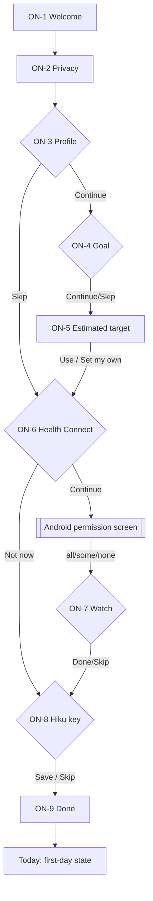

| Step | User action | System feedback | Validation and errors | Cancel / recovery |
|---|---|---|---|---|
| ON-1 | Get started | Next screen | — | Back exits the app (nothing saved yet) |
| ON-2 | I understand | Saves "privacy acknowledged" | — | Back to ON-1 |
| ON-3 | Enters data | Inline unit hints | Range errors under each field; Continue disabled until valid or Skip | Back keeps entered values |
| ON-5 | Accepts or edits target | Target saved locally | Safety-floor warning; < 1,000 kcal blocked | "Set my own numbers" → editor sheet; Cancel returns |
| ON-6 | Opens Android permissions | Summary of granted types on return | HC unavailable → update prompt | "Not now" → Today shows "Connect" later |
| ON-8 | Pastes key | Masked; "Saved" | Malformed-key error; offline save allowed | Skip; set later in Settings |
| ON-9 | Open Today | Lands on Today (first day) | — | — |

**Interrupted onboarding:** reopening the app resumes at the last unfinished step. After the Privacy screen, the user can tap "Finish later": Today opens with the remaining steps listed in Getting started.

---

## Flow 6 (setup): Add an Anthropic key

Entry points: ON-8, the Today Hiku card "Add API key", Settings → Hiku, and the Hiku tab's no-key state (1C).

1. The user pastes a key → format check.
2. Save → secure storage → chip changes to "Key saved".
3. Optional "Test key" (online only), with these results:
   - ✓ "Hiku is ready"
   - **401:** "This key is invalid or revoked." Replace it.
   - **403:** "This key isn't allowed to use this model."
   - **429:** "Anthropic is rate limiting this key. Try again in a minute."
   - **Offline:** "Saved. We'll test it when you're online."
4. Delete key (Settings) → confirmation sheet: "Hiku will stop working until you add a key." → removed from secure storage.

The key never appears again after saving: only "Key saved · ending ••a1b2".

---

## Flow 7: Open with no internet

1. App launches → reads local data immediately (no network wait) → Today renders. **Proven on the S22:** offline cold start, local DB and offline Claude failure all PASS (Phase 0, device test 2).
2. Offline banner appears at the top of Today: "Offline. Logging, workouts and your history work as usual. Hiku needs internet."
3. **Hiku entry points:**
   - The Today Hiku card turns into the offline state, and the Photo button is hidden.
   - The Hiku tab shows an offline state with "Log manually" (HK-1, 1C).
4. Health Connect still works offline: it's on-device, so steps and HR update normally.
5. Connectivity returns → the banner disappears within 5 s → Hiku re-enables. **No automatic AI requests are sent on reconnect.**
6. If the user starts a Hiku request just as the connection drops, it fails as "You're offline. Nothing was saved." Their text or photo stays in the composer to retry.

---

## Flow 2: Create a workout → start → log sets → finish (1B)

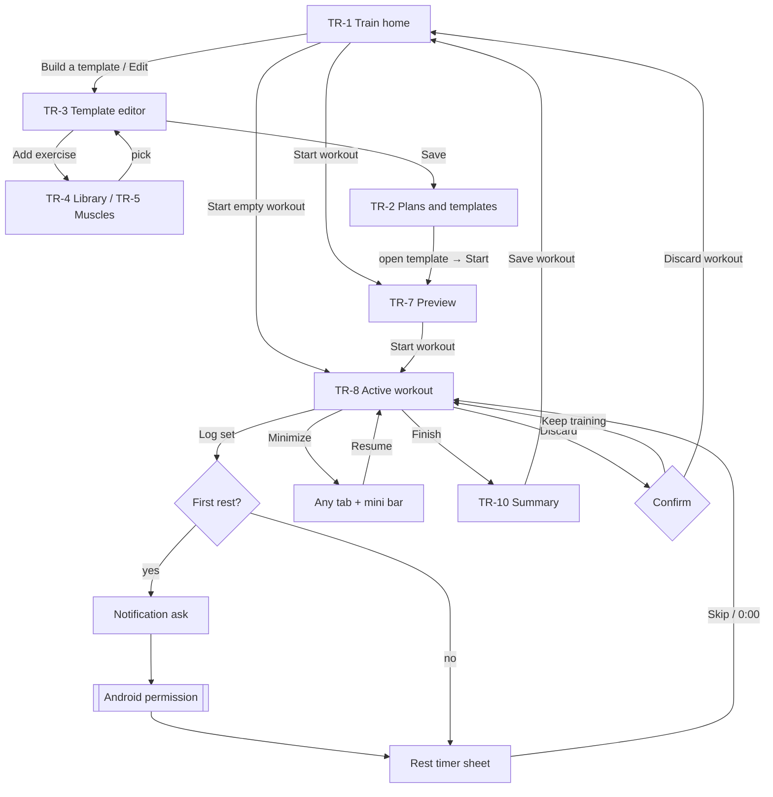

| Step | User action | System feedback | Validation and errors | Cancel / recovery |
|---|---|---|---|---|
| TR-3 | Name, add exercises, set sets × reps and rest, Save | Saved template appears in TR-2; snackbar "Template saved" | Save is disabled until there's a name and one exercise, with a hint. A duplicate name is allowed but gets " (2)". | Back with changes → "Discard changes?" (Keep editing is the default) |
| TR-4/5 | Search or browse, tap exercise, Add | Returns to the editor with the exercise added at the end | No results → "Create '<query>'" | Back returns without adding |
| TR-7 | Start workout | Opens TR-8 at exercise 1, set 1, prefilled from last time | — | Back returns to TR-1; nothing is created yet |
| TR-8 | Adjust kg/reps, Log set | Row ticks, haptic, next set selected, rest sheet opens with "Set 3 logged · Undo" | 0 reps can't be logged ("Add reps first"). Weight > 500 kg or reps > 100 asks "Is that right?". Suggested values are never logged without a tap. | Undo on the rest sheet; later, the logged row's tick; correct values by tapping them |
| Rest | −15 / +15 / Skip, or wait | Countdown from a stored deadline in the orb and top bar; when the screen is off, a notification tries to alert at 0:00 (pending device test) | Notification denied → in-app alert only, with a banner | Dismiss the sheet; the timer keeps running |
| Minimize | Chevron or system back | Previous screen + mini bar on every tab | — | Resume from the mini bar or TR-1 hero |
| Finish | Finish → Save workout | Summary, records computed, history updated, Today's Training card shows "Done" | Unlogged sets → "3 sets have no reps. Finish anyway?" | "Back to workout" returns to TR-8 |
| App killed mid-workout | — (system) | Next launch opens TR-1 with the in-progress hero; all logged sets intact | Every set is saved on Log set | Resume or Discard |
| Discard | Discard → Discard workout | Workout and its sets deleted; back to TR-1 | — | Keep training is the default button |

## Flow 10 (workouts): Edit or delete a logged workout (1B)

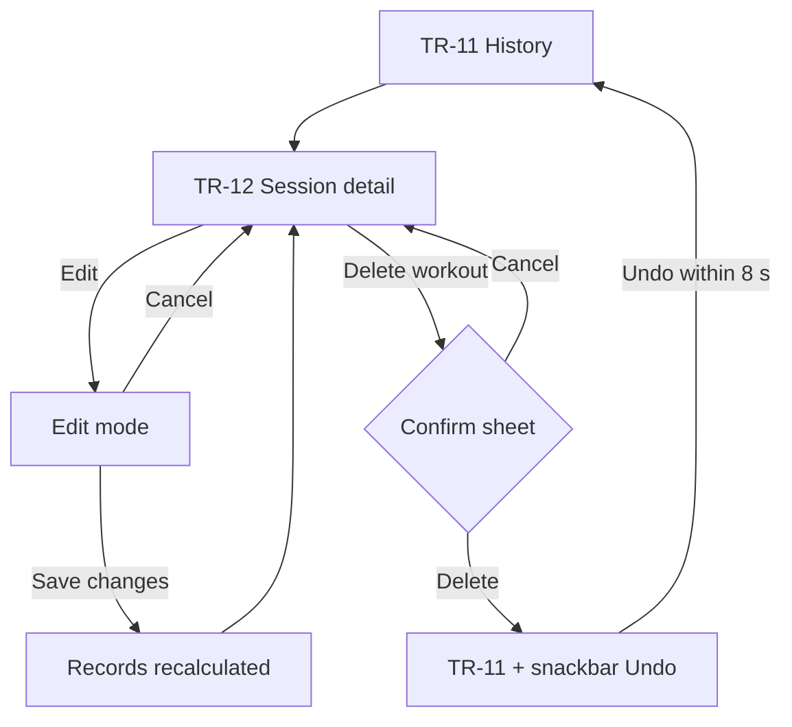

| Step | User action | System feedback | Validation and errors | Cancel / recovery |
|---|---|---|---|---|
| Edit | Pencil → change kg/reps, remove or add sets → Save changes | "Saved. Records updated." Changed records are listed if any moved | Same limits as logging; an exercise with all sets removed asks "Remove Barbell row from this workout?" | Cancel or back → "Discard changes?" |
| Delete | Delete workout → Delete | The sheet names the records that will revert; history shows the snackbar with Undo | — | Cancel is always available; Undo within 8 s restores the workout and its records exactly |
| After Undo expires | — | Deletion is final (local data, no trash in V1) | — | Export/backup is a future feature (1D) |

---

## Flow 3: Add a meal manually → edit → save (1C)

```mermaid
flowchart TD
  T[Today: Log a meal / Dinner Add] --> B
  E[EA-1 Eat home: Add] --> B[EA-2 Add food]
  B -- tap "+" --> U[Added to meal + Undo snackbar]
  B -- tap row --> C[EA-3 Portion picker]
  C -- Add to Dinner --> D[EA-1 + Undo snackbar]
  B -- no result / link --> F[EA-5 Create a food or Quick add]
  F -- Save --> C
  D -- tap a meal item --> G[EA-4 Meal detail]
  G -- tap an item --> H[Inline edit: stepper, Remove item]
  H -- Done --> G
  U -- Undo within 4 s --> B
```

| Step | User action | System feedback | Validation and errors | Cancel / recovery |
|---|---|---|---|---|
| Start | Today "Log a meal" (dinner after 17:00), Today meals card "Add", or Eat "Add" on a meal | EA-2 opens with the meal preset and the capsule nav still visible | — | Back returns to where the user came from |
| EA-2 | Types in search, or taps Recents | Local results with per-100 g kcal and a source chip; works offline | No match: "Not in the food pack" with Create a food, Quick add calories and Describe it to Hiku (the last disabled offline) | Back |
| One-tap add | Taps "+" on a row | The last-used portion is added to the selected meal; snackbar "Greek yogurt, 170 g added to Dinner. Undo" (4 s) | — | **Undo** within 4 s |
| EA-3 | Taps the row, picks a unit, sets the amount | kcal and macros update live; the stored amount is always grams | 0 g can't be added; more than 2,000 g asks "Is that right?" | Back returns to EA-2 with nothing added |
| Save | Add to Dinner | EA-1 with the meal total, the orb and Today updated at once; snackbar with Undo | — | Undo within 4 s |
| EA-5 | Fills in a food (or Quick add) | The new food opens in EA-3 as "My food" | Name required; calories and macros that differ by more than 20% show a hint and **Save anyway** | Back keeps the typed values |
| EA-4 | Taps a meal item, changes the portion | The meal total updates live ("was 680") | Same limits as EA-3 | **Done** or Back; Remove item removes it |

## Flow 4: Meal photo → Hiku → review and correct → save (1C)

Status: **Pending device test** (no real Claude request has been run on the S22).

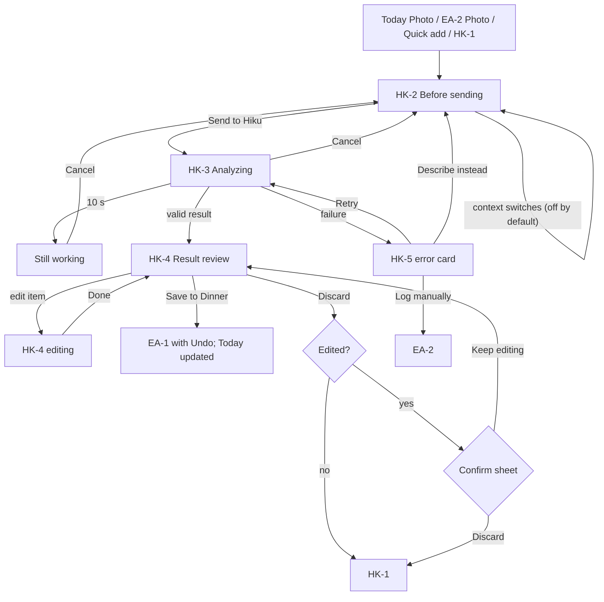

| Step | User action | System feedback | Validation and errors | Cancel / recovery |
|---|---|---|---|---|
| HK-2 | Picks or takes a photo, adds an optional note, optionally turns on Today's totals or Training day | "What's sent" lists exactly what leaves the phone, with the estimated cost (≈ $0.007 for a photo) | Offline or no key: the entry points are disabled with a reason before this screen | Back; nothing was sent |
| Send | Send to Hiku | HK-3 with Cancel; the photo is resized on the phone first | — | Cancel returns to HK-2 with the input intact; the request may still be billed |
| HK-3 | Waits | After 10 s: "Still working… This can take up to 45 s." | 45 s: timeout card | Cancel is always visible |
| HK-4 | Reviews items; taps one to edit (grams stepper) or Remove; Add item | Totals and the "After saving" line update live; the original estimate stays visible ("Hiku said 624") | Invalid or cut-off response never reaches this screen | Discard asks only if something was edited |
| Save | Save to Dinner | EA-1 shows the dinner and the new total; snackbar with Undo; the diary items are saved with `source = hiku-estimate` and the original estimate | — | **Undo**; or delete from EA-4 |
| Failure | — | HK-5 card with the cause, what was kept, and actions | See INTERACTION_AND_STATES (seven cases) | Retry, fix the key, describe instead, or log manually |

## Flow 6 (request): The first AI request after adding a key (1C)

Entry: the user added a key in ON-8 or Settings, then taps Photo or Describe for the first time. Status: **Pending device test.**

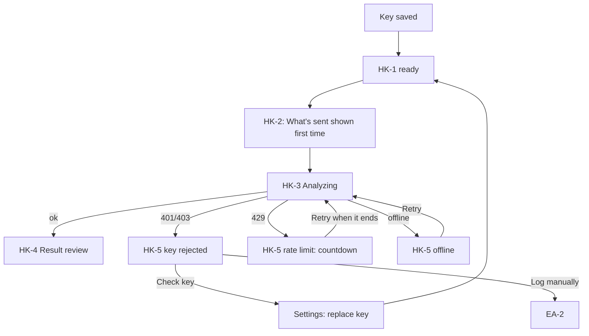

| Step | User action | System feedback | Validation and errors | Cancel / recovery |
|---|---|---|---|---|
| First request | Photo or Describe → Send | The privacy line and cost estimate are shown on HK-2 as always. Nothing is sent before Send. | — | Back |
| Key rejected (401/403) | — | "Your API key was rejected. Anthropic did not accept the key saved on this phone." The input is kept. | The key is never shown again, only "Key saved · ending ••a1b2" | **Check key** (Settings, replace it) or **Log manually** |
| Rate limit (429) | — | "Too many requests right now. Try again in about 30 s." with a countdown | Retry unlocks when the countdown ends | Log manually meanwhile |
| Success | — | HK-4; the HK-1 usage line gains the request | — | Discard |

## Flow 10 (meals): Edit or delete a meal or item, with Undo (1C)

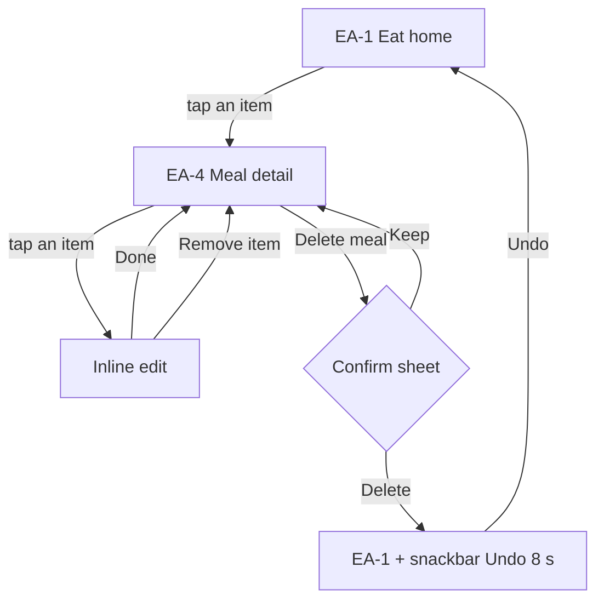

| Step | User action | System feedback | Validation and errors | Cancel / recovery |
|---|---|---|---|---|
| Edit an item | Tap its row → change grams → Done | Item kcal, meal total and the day total update live; Today updates at once | Same limits as EA-3 | Back before Done discards the change |
| Remove an item | Remove item | The row leaves the list; the meal total drops | A meal with no items reads "Not logged yet", not 0 | Undo snackbar, 8 s |
| Move a meal's items | Move to another meal | The items change meal; totals follow | — | Undo snackbar, 8 s |
| Delete a meal | Delete meal → Delete | Sheet "Delete lunch? 4 items, 680 kcal. You can undo for 8 s." then EA-1 with "Lunch deleted. 4 items, 680 kcal. Undo" | — | **Keep** is the default button; Undo within 8 s restores the meal exactly |
| After Undo expires | — | Deletion is final (local data, no trash in V1) | — | Export is a future feature (1D). A whole-day clear isn't in V1. |

---

## Flow 5: Connect Health Connect → permissions → inspect data and sources (1D)

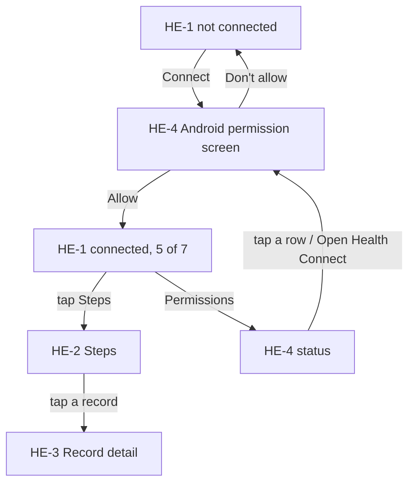

| Step | User action | System feedback | Validation and errors | Cancel / recovery |
|---|---|---|---|---|
| Start | Onboarding ON-6, or Progress → Health details, or Settings → Health Connect | HE-1 in its not-connected state: what Liftria reads, "it never writes", "data starts on the day you connect" | Health Connect missing or too old: "Get Health Connect" and "Liftria works without it". Health Connect off: "hidden, not zero" and Turn on | Not now returns to Progress |
| Connect | Taps Connect | Android's own permission screen opens (HE-4 reference mock) | Android may show only some types | Don't allow returns to HE-1 not connected; nothing is lost |
| Result | Taps Allow | HE-1 connected: one row per type with value or state, source chip and age; permissions "5 of 7 allowed"; data from the connect date | A denied type is "Not allowed" with a lock, never "0" | Permissions opens HE-4; a row or **Open Health Connect** opens Android's screen to change it |
| Inspect | Taps Steps | HE-2: chart with its source line, Sources breakdown (each origin on its own), what the number means | One origin only: a total is shown. Two origins: listed separately | Back returns to HE-1 |
| Inspect a record | Taps a record | HE-3: value, time, data origin and package, device, recorded vs read, permission | A missing device reads "Not recorded by the source" | Back returns to HE-2 |

Entry from Today: the **Activity card steps** open HE-2 (steps) and the **heart-rate row** opens HE-3; back returns to Today.

## Flow 8: Investigate missing watch data (1D)

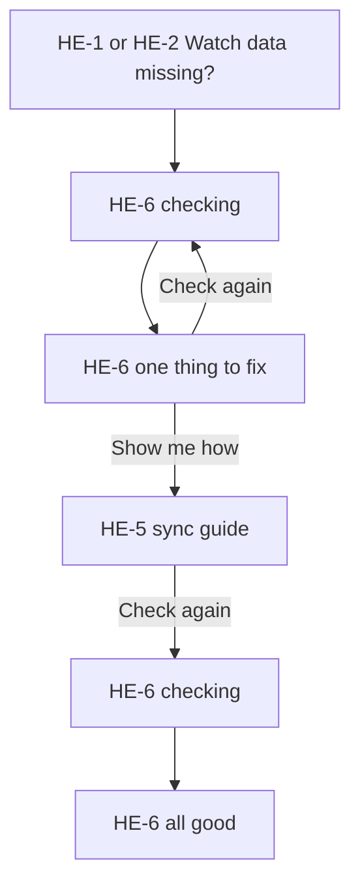

| Step | User action | System feedback | Validation and errors | Cancel / recovery |
|---|---|---|---|---|
| Start | Taps "Watch data missing?" | HE-6 runs five checks one by one, each with a status icon and a word | — | Back returns to where they came from |
| Result: issue | Waits (a moment) | Rows ✓ for Health Connect installed, heart rate allowed and Samsung Health writing ("Last record 2 h ago"); ④ **info** "Can't be checked from here. Open Samsung Health and check the watch is synced"; ⑤ ✕ "None yet, only phone steps". The failing row opens with the fix "Turn on Steps in Samsung Health → Health Connect" | The watch sync can't be verified from the phone side, so it is never ticked | Check again re-runs |
| Fix | Show me how | HE-5: five steps with drawings and "Data starts from the day you connect" | — | Back |
| Re-check | Check again | HE-6 re-runs; with steps arriving, "Watch data is arriving" with every checkable row ✓ | Steps can take a few minutes to appear | Check again |

## Flow 9: Review progress (1D)

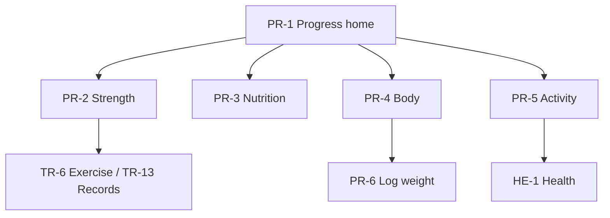

| Step | User action | System feedback | Validation and errors | Cancel / recovery |
|---|---|---|---|---|
| Overview | Opens the Progress tab | Four cards, each with a headline, its own source line and a link | A card with no data shows one sentence and one action ("Log your weight…") | Range chips change the window (4 W, 3 M, 1 Y) |
| Strength | Strength details | Weekly volume bars, top lifts with Estimate chip, records | Empty: "Finish a workout to see strength trends" | Back |
| Nutrition | Nutrition trends | Calories as a line with gaps for unlogged days, protein days, average split | Unlogged days are gaps, not zeros; "18 of 28 days logged" | Back |
| Body | Body details | Weight dots and the 7-day average, range, last entry with source | Empty: "Log your weight to see a trend". Hide numbers: "Trend: steady" | Log weight opens PR-6 |
| Activity | Activity details | Steps per day by source; resting HR and sessions Pending | Health Connect off: hidden, not zero, Turn on | Health details opens HE-1 |

## Flow 10 (all data): Edit or delete a weight, clear the health cache, delete all data (1D)

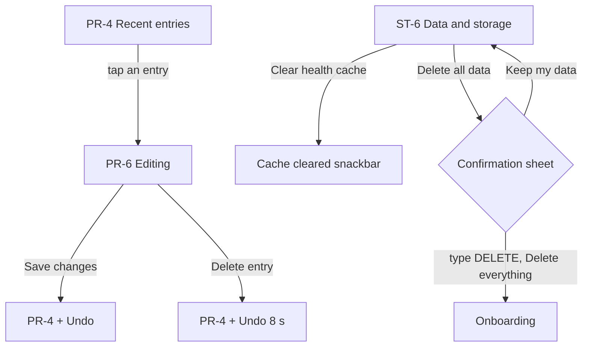

| Step | User action | System feedback | Validation and errors | Cancel / recovery |
|---|---|---|---|---|
| Edit a weight | PR-4 → tap an entry → change → Save changes | The trend and the Settings weight update; snackbar with Undo | Outside 20 to 300 kg: "Is that right?" with Fix it | Cancel keeps the entry |
| Delete a weight | Delete entry | "Entry deleted" with Undo for 8 s | Entries read from Health Connect can't be edited or deleted here | Undo restores it exactly |
| Clear health cache | ST-6 → Clear health cache | Counts show 0 cached; "Liftria reads Health Connect again next time" | Only cached Health Connect rows go; workouts, meals and weights stay | The next read re-imports them |
| Delete all data | ST-6 → Delete all data | Sheet listing what is deleted and what isn't (Health Connect and Samsung Health data, Anthropic's logs for your key); "Type DELETE to confirm", button disabled | The button enables only for exactly DELETE | **Keep my data** is the primary button; the scrim also closes it |
| After | Delete everything | The database, the key and cached files are removed, then Liftria restarts into onboarding | A failed step is reported; it never claims success first | **No Undo.** Export is a Future feature, so this is final |

## Flow 6 (key management): Replace, test and delete the API key (1D)

Entry points: Settings → Hiku and API key; HK-1 "Add API key" and HK-6 "API key" (back returns to the Hiku tab); HK-5 "Check key"; the Today Hiku card.

| Step | User action | System feedback | Validation and errors | Cancel / recovery |
|---|---|---|---|---|
| Test | Test key (online) | A "Testing…" row, then "Key works" with a `pending` "First device test" chip | 401 "This key is invalid or revoked"; 403 "This key isn't allowed to use this model"; 429 "Anthropic is rate limiting this key. Try again in a minute"; offline "We'll test it when you're online" | Back |
| Replace | Replace key → paste → Save key | The masked key line updates to the new "…last 4" | Format check, as ON-8 | Cancel keeps the old key |
| Delete | Delete key | Sheet: "Hiku stops working until you add a key. Your food diary isn't affected." Keep key is the primary button | — | Keep key; after deleting, Hiku shows its no-key states |
| Privacy defaults | Today's totals, Training day, Keep photos | Three switches, all off; they are the starting positions for each request | — | Each request can still change them (HK-2) |

---

## Flow 11: Import history from another app, and Undo import (1E, Future · Phase 3)

Entry points: Settings → Data and storage → "Import workouts from another app"; the first-time Train home link "Switching from another app? Import your history"; the empty History link (same words). Back from IM-1 returns to the entry point. The whole flow is a pushed stack with no capsule nav, and **nothing is saved until Import is tapped**.

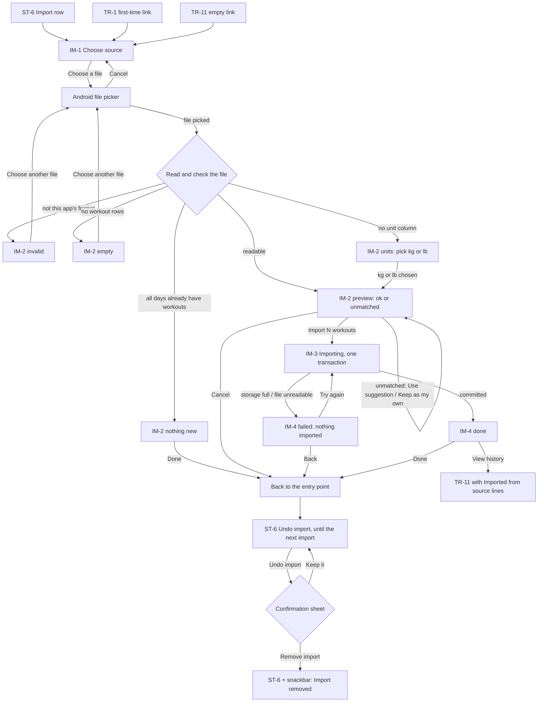

| Step | User action | System feedback | Validation and errors | Cancel / recovery |
|---|---|---|---|---|
| 1 Choose source | Tap Hevy, Strong, FitNotes or Another app (CSV); Choose a file | The row is selected; the export path for that app is on its row; the privacy line is visible ("The file stays on this phone…") | — | Back returns to the entry point; the Future list says what isn't here (Hevy account import, Apple Health weight, export) |
| 2 Pick the file | Android's document picker | Liftria reads only the picked file; no storage permission is asked | A file that can't be opened shows the failed state of IM-4 ("couldn't be read") | Cancel in the picker returns to IM-1 |
| 3 Check | Automatic, before anything is saved | A short "Reading…" in the preview header | **Invalid:** "This doesn't look like a Hevy export" with the columns expected and the columns found. **Empty:** "No workouts found in this file." **Too large:** the same layout as invalid ("too large to import") | Choose another file; Pick a different app; nothing was saved |
| 4 Units (only if needed) | Choose kg or lb | Import turns on; the hint says "Weights will be read as lb." | The file has no unit column; Liftria never guesses, so Import stays off until one is chosen | Cancel leaves everything as it was |
| 5 Review | Read the summary, the skipped days, the warm-up line and the records preview | "142 workouts · 3,910 sets · Mar 2023 – Oct 2026 · from Hevy"; "2 days already have a workout in Liftria and will be skipped"; "Your bench record will become 92.5 kg × 3 (from Hevy, 12 Aug 2026)" | **Nothing new:** every workout's day already has one, so Import isn't offered ("Nothing new to import") | Cancel; back |
| 6 Unmatched exercises (only if any) | Per exercise: Use "Bench press" or Keep as my own | The *Suggested* match is shown, never applied for the user; the count of custom exercises updates; the records card follows the choice | Nothing blocks the import; with no choice, each becomes a custom exercise with no muscles (so it doesn't count in the muscle map) | Choices can be changed until Import; they're remembered for the next import |
| 7 Import | Import 142 workouts | IM-3: "Importing… 61 of 142 workouts" with a bar; "It can't be cancelled halfway: it either all happens or none of it does" | **Storage full:** "This phone is almost out of storage. Liftria needs about 4 MB and found 1.1 MB free." **File unreadable:** "Liftria couldn't read the file all the way through." Either rolls back: "Nothing was imported", "Your existing workouts are untouched" | No cancel while it runs (one transaction). Try again, or Back. If the app is killed mid-import, the next launch rolls it back and says so |
| 8 Done | — | "142 workouts imported"; sets saved; custom exercises created (6 if none were matched); records updated; "2 workouts skipped"; a note that Undo import stays in Settings until the next import | — | View history opens TR-11, where imported sessions carry "Imported from Hevy" (and TR-12 shows the import date); Done returns to the entry point |
| 9 Re-import the same file | Run steps 1 to 3 with the same file | IM-2 "Nothing new to import. All 144 workouts in this file are already in Liftria." | **Re-importing the same file adds nothing**: every day now has a workout, and the file's hash is remembered | Done; Choose another file |
| 10 Undo import | ST-6 → Undo import | The sheet "Remove the 142 imported workouts?" lists what is removed (the workouts and sets, the custom exercises this import created if nothing else uses them) and what isn't (your own workouts, templates and plans; exercises matched to the library); "Records are recalculated. You can import the file again later." Result: snackbar "Import removed: 142 workouts and 6 custom exercises. Records recalculated." | **Removes exactly that batch**, nothing else. If the user edited an imported session since, it still goes (the sheet says so) | **Keep it** is the primary button, and the scrim also closes the sheet. There is no second Undo; importing the file again restores the workouts |
| 11 The next import | Any later import | "Undo import" now refers to the new batch; the old batch can no longer be undone as a batch | — | Delete single sessions in TR-12 as usual |

**Flow 11b, muscle map entry (1E).** Train → the Muscles card (TR-1) → TR-14, or Progress → Strength → "Muscle map" → TR-14. In TR-14: switch **Recent · Volume · Untrained**; tap a muscle row or a region → TR-5 filtered to that muscle; in `untrained`, **Find exercises** does the same. Back returns one level at a time (TR-5 → TR-14 → the entry point). With no logged workouts TR-14 shows its empty state and **Start a workout**.
