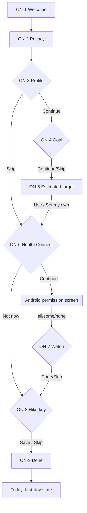
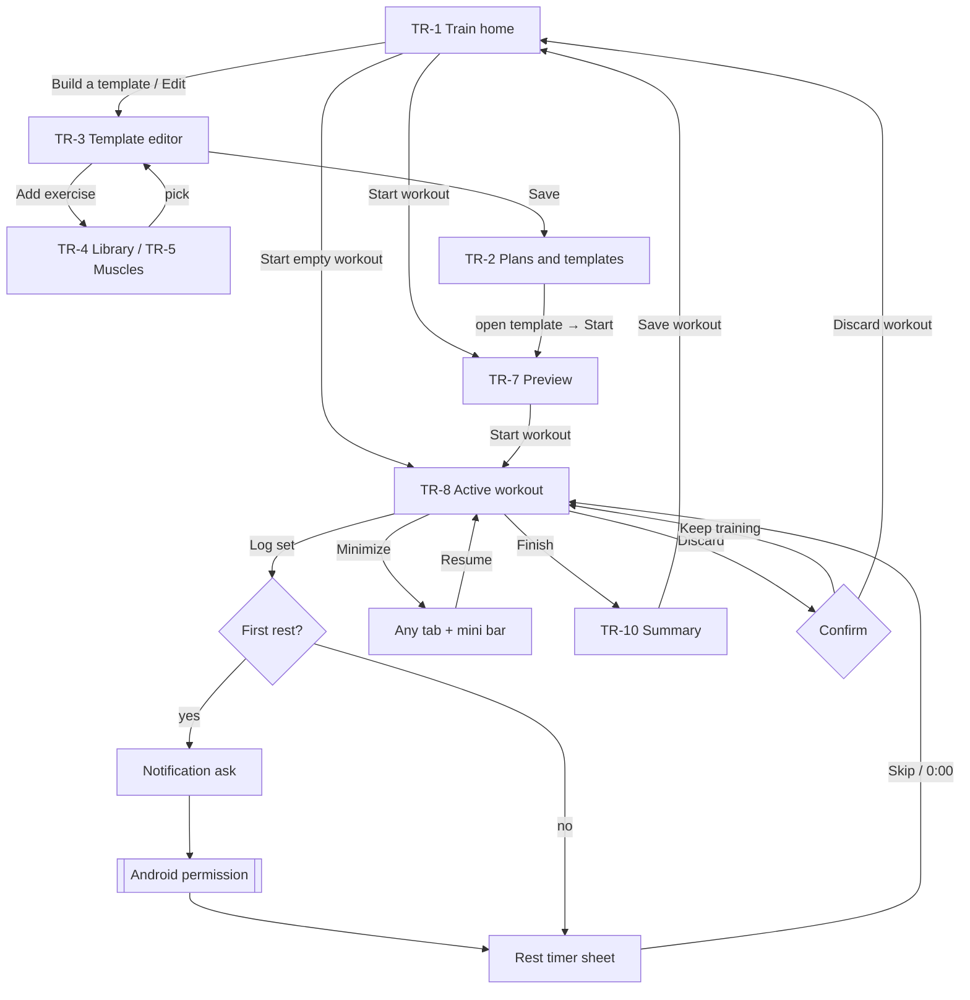
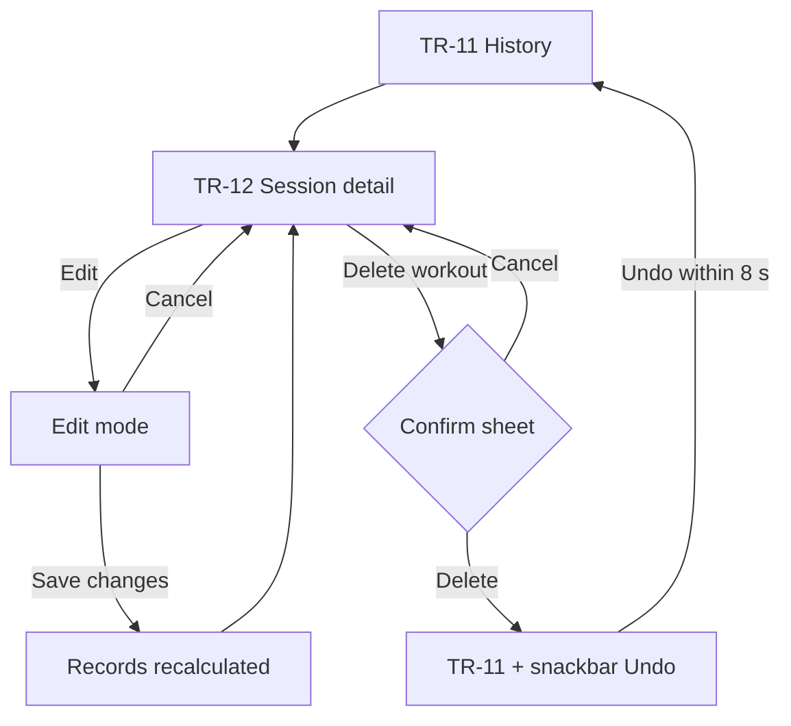
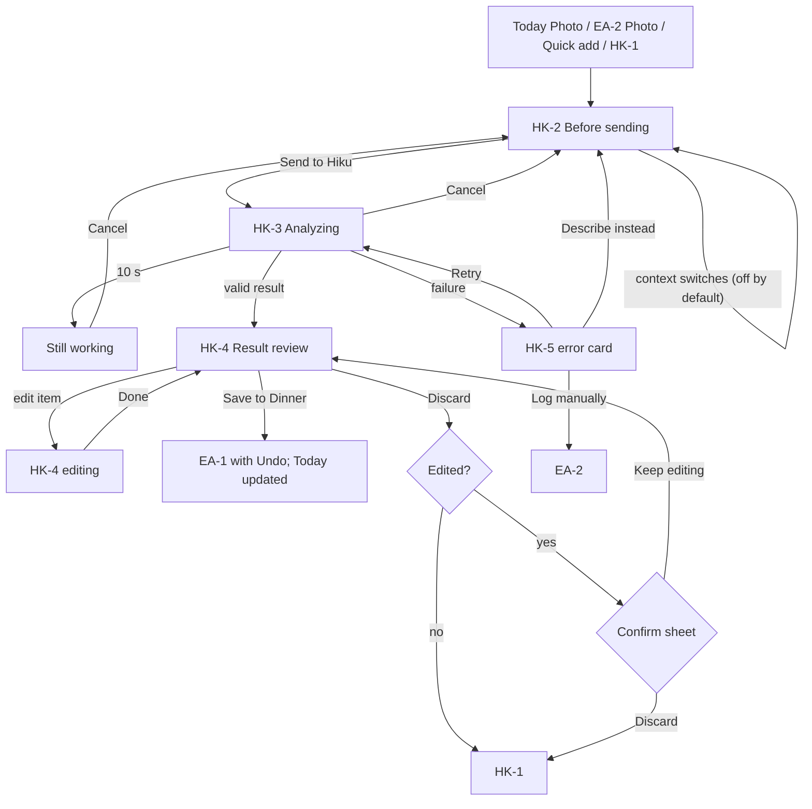
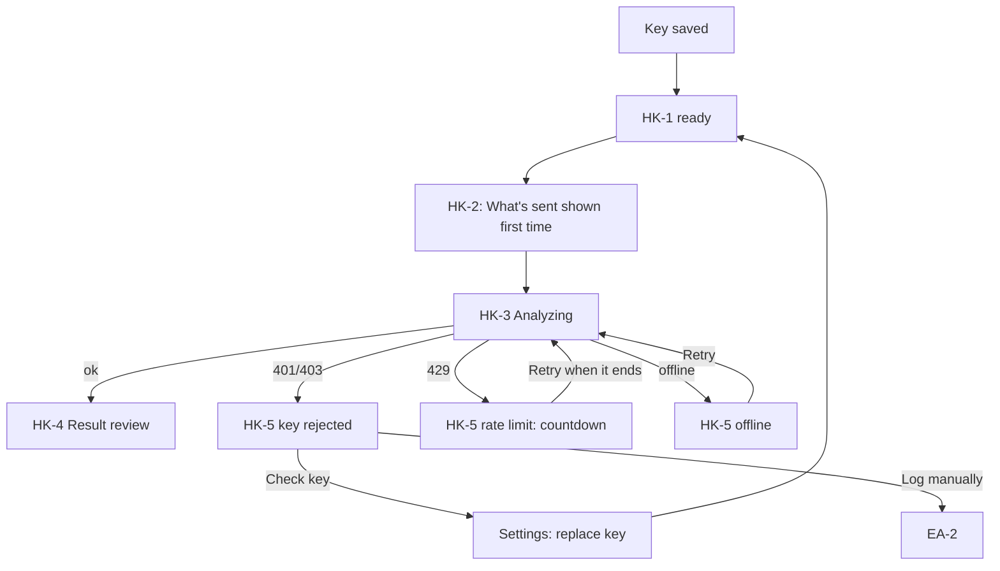
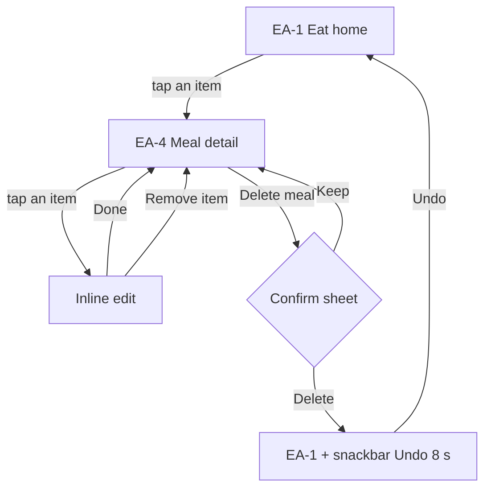

# User Flows

**Milestone 1A** covers flows 1, 6 (setup part) and 7. **Milestone 1B** adds flow 2 and the workout part of flow 10. **Milestone 1C** adds flows 3, 4, the request part of flow 6, and the meal part of flow 10. Flows 5, 8, 9 and the rest of 10 are added in 1D.

| # | Flow | Milestone |
|---|---|---|
| 1 | First launch → onboarding → Today | **1A** |
| 2 | Create workout → start → log sets → finish | **1B** |
| 3 | Add meal manually → edit → save | **1C** |
| 4 | Meal photo → Hiku → review → save | **1C** |
| 5 | Connect Health Connect → permissions → inspect sources | 1D (entry in 1A, ON-6) |
| 6 | Set up API key → first AI request | **1A** (setup), **1C** (request) |
| 7 | Open with no internet → continue offline | **1A** |
| 8 | Investigate missing watch data | 1D |
| 9 | Review progress | 1D |
| 10 | Edit or delete data | **1B** (workouts), **1C** (meals), 1D (all data) |

---

## Flow 1: First launch → onboarding → Today



| Step | User action | System feedback | Validation and errors | Cancel / recovery |
|---|---|---|---|---|
| ON-1 | Get started | Next screen | — | Back exits the app (nothing saved yet) |
| ON-2 | I understand | Saves "privacy acknowledged" | — | Back to ON-1 |
| ON-3 | Enters data | Inline unit hints | Range errors under each field; Continue disabled until valid or Skip | Back keeps entered values |
| ON-5 | Accepts or edits target | Target saved locally | Safety-floor warning; < 1,000 kcal blocked | "Set my own numbers" → editor sheet; Cancel returns |
| ON-6 | Opens Android permissions | Summary of granted types on return | HC unavailable → update prompt | "Not now" → Today shows "Connect" later |
| ON-8 | Pastes key | Masked; "Saved" | Malformed-key error; offline save allowed | Skip; set later in Settings |
| ON-9 | Open Today | Lands on Today (first day) | — | — |

**Interrupted onboarding:** reopening the app resumes at the last unfinished step. After the Privacy screen, the user can tap "Finish later": Today opens with the remaining steps listed in Getting started.

---

## Flow 6 (setup): Add an Anthropic key

Entry points: ON-8, the Today Hiku card "Add API key", Settings → Hiku, and the Hiku tab's no-key state (1C).

1. The user pastes a key → format check.
2. Save → secure storage → chip changes to "Key saved".
3. Optional "Test key" (online only), with these results:
   - ✓ "Hiku is ready"
   - **401:** "This key is invalid or revoked." Replace it.
   - **403:** "This key isn't allowed to use this model."
   - **429:** "Anthropic is rate limiting this key. Try again in a minute."
   - **Offline:** "Saved. We'll test it when you're online."
4. Delete key (Settings) → confirmation sheet: "Hiku will stop working until you add a key." → removed from secure storage.

The key never appears again after saving: only "Key saved · ending ••a1b2".

---

## Flow 7: Open with no internet

1. App launches → reads local data immediately (no network wait) → Today renders. **Proven on the S22:** offline cold start, local DB and offline Claude failure all PASS (Phase 0, device test 2).
2. Offline banner appears at the top of Today: "Offline. Logging, workouts and your history work as usual. Hiku needs internet."
3. **Hiku entry points:**
   - The Today Hiku card turns into the offline state, and the Photo button is hidden.
   - The Hiku tab shows an offline state with "Log manually" (HK-1, 1C).
4. Health Connect still works offline: it's on-device, so steps and HR update normally.
5. Connectivity returns → the banner disappears within 5 s → Hiku re-enables. **No automatic AI requests are sent on reconnect.**
6. If the user starts a Hiku request just as the connection drops, it fails as "You're offline. Nothing was saved." Their text or photo stays in the composer to retry.

---

## Flow 2: Create a workout → start → log sets → finish (1B)



| Step | User action | System feedback | Validation and errors | Cancel / recovery |
|---|---|---|---|---|
| TR-3 | Name, add exercises, set sets × reps and rest, Save | Saved template appears in TR-2; snackbar "Template saved" | Save is disabled until there's a name and one exercise, with a hint. A duplicate name is allowed but gets " (2)". | Back with changes → "Discard changes?" (Keep editing is the default) |
| TR-4/5 | Search or browse, tap exercise, Add | Returns to the editor with the exercise added at the end | No results → "Create '<query>'" | Back returns without adding |
| TR-7 | Start workout | Opens TR-8 at exercise 1, set 1, prefilled from last time | — | Back returns to TR-1; nothing is created yet |
| TR-8 | Adjust kg/reps, Log set | Row ticks, haptic, next set selected, rest sheet opens with "Set 3 logged · Undo" | 0 reps can't be logged ("Add reps first"). Weight > 500 kg or reps > 100 asks "Is that right?". Suggested values are never logged without a tap. | Undo on the rest sheet; later, the logged row's tick; correct values by tapping them |
| Rest | −15 / +15 / Skip, or wait | Countdown from a stored deadline in the orb and top bar; when the screen is off, a notification tries to alert at 0:00 (pending device test) | Notification denied → in-app alert only, with a banner | Dismiss the sheet; the timer keeps running |
| Minimize | Chevron or system back | Previous screen + mini bar on every tab | — | Resume from the mini bar or TR-1 hero |
| Finish | Finish → Save workout | Summary, records computed, history updated, Today's Training card shows "Done" | Unlogged sets → "3 sets have no reps. Finish anyway?" | "Back to workout" returns to TR-8 |
| App killed mid-workout | — (system) | Next launch opens TR-1 with the in-progress hero; all logged sets intact | Every set is saved on Log set | Resume or Discard |
| Discard | Discard → Discard workout | Workout and its sets deleted; back to TR-1 | — | Keep training is the default button |

## Flow 10 (workouts): Edit or delete a logged workout (1B)



| Step | User action | System feedback | Validation and errors | Cancel / recovery |
|---|---|---|---|---|
| Edit | Pencil → change kg/reps, remove or add sets → Save changes | "Saved. Records updated." Changed records are listed if any moved | Same limits as logging; an exercise with all sets removed asks "Remove Barbell row from this workout?" | Cancel or back → "Discard changes?" |
| Delete | Delete workout → Delete | The sheet names the records that will revert; history shows the snackbar with Undo | — | Cancel is always available; Undo within 8 s restores the workout and its records exactly |
| After Undo expires | — | Deletion is final (local data, no trash in V1) | — | Export/backup is a future feature (1D) |

---

## Flow 3: Add a meal manually → edit → save (1C)

```mermaid
flowchart TD
  T[Today: Log a meal / Dinner Add] --> B
  E[EA-1 Eat home: Add] --> B[EA-2 Add food]
  B -- tap "+" --> U[Added to meal + Undo snackbar]
  B -- tap row --> C[EA-3 Portion picker]
  C -- Add to Dinner --> D[EA-1 + Undo snackbar]
  B -- no result / link --> F[EA-5 Create a food or Quick add]
  F -- Save --> C
  D -- tap a meal item --> G[EA-4 Meal detail]
  G -- tap an item --> H[Inline edit: stepper, Remove item]
  H -- Done --> G
  U -- Undo within 4 s --> B
```

| Step | User action | System feedback | Validation and errors | Cancel / recovery |
|---|---|---|---|---|
| Start | Today "Log a meal" (dinner after 17:00), Today meals card "Add", or Eat "Add" on a meal | EA-2 opens with the meal preset and the capsule nav still visible | — | Back returns to where the user came from |
| EA-2 | Types in search, or taps Recents | Local results with per-100 g kcal and a source chip; works offline | No match: "Not in the food pack" with Create a food, Quick add calories and Describe it to Hiku (the last disabled offline) | Back |
| One-tap add | Taps "+" on a row | The last-used portion is added to the selected meal; snackbar "Greek yogurt, 170 g added to Dinner. Undo" (4 s) | — | **Undo** within 4 s |
| EA-3 | Taps the row, picks a unit, sets the amount | kcal and macros update live; the stored amount is always grams | 0 g can't be added; more than 2,000 g asks "Is that right?" | Back returns to EA-2 with nothing added |
| Save | Add to Dinner | EA-1 with the meal total, the orb and Today updated at once; snackbar with Undo | — | Undo within 4 s |
| EA-5 | Fills in a food (or Quick add) | The new food opens in EA-3 as "My food" | Name required; calories and macros that differ by more than 20% show a hint and **Save anyway** | Back keeps the typed values |
| EA-4 | Taps a meal item, changes the portion | The meal total updates live ("was 680") | Same limits as EA-3 | **Done** or Back; Remove item removes it |

## Flow 4: Meal photo → Hiku → review and correct → save (1C)

Status: **Pending device test** (no real Claude request has been run on the S22).



| Step | User action | System feedback | Validation and errors | Cancel / recovery |
|---|---|---|---|---|
| HK-2 | Picks or takes a photo, adds an optional note, optionally turns on Today's totals or Training day | "What's sent" lists exactly what leaves the phone, with the estimated cost (≈ $0.007 for a photo) | Offline or no key: the entry points are disabled with a reason before this screen | Back; nothing was sent |
| Send | Send to Hiku | HK-3 with Cancel; the photo is resized on the phone first | — | Cancel returns to HK-2 with the input intact; the request may still be billed |
| HK-3 | Waits | After 10 s: "Still working… This can take up to 45 s." | 45 s: timeout card | Cancel is always visible |
| HK-4 | Reviews items; taps one to edit (grams stepper) or Remove; Add item | Totals and the "After saving" line update live; the original estimate stays visible ("Hiku said 624") | Invalid or cut-off response never reaches this screen | Discard asks only if something was edited |
| Save | Save to Dinner | EA-1 shows the dinner and the new total; snackbar with Undo; the diary items are saved with `source = hiku-estimate` and the original estimate | — | **Undo**; or delete from EA-4 |
| Failure | — | HK-5 card with the cause, what was kept, and actions | See INTERACTION_AND_STATES (seven cases) | Retry, fix the key, describe instead, or log manually |

## Flow 6 (request): The first AI request after adding a key (1C)

Entry: the user added a key in ON-8 or Settings, then taps Photo or Describe for the first time. Status: **Pending device test.**



| Step | User action | System feedback | Validation and errors | Cancel / recovery |
|---|---|---|---|---|
| First request | Photo or Describe → Send | The privacy line and cost estimate are shown on HK-2 as always. Nothing is sent before Send. | — | Back |
| Key rejected (401/403) | — | "Your API key was rejected. Anthropic did not accept the key saved on this phone." The input is kept. | The key is never shown again, only "Key saved · ending ••a1b2" | **Check key** (Settings, replace it) or **Log manually** |
| Rate limit (429) | — | "Too many requests right now. Try again in about 30 s." with a countdown | Retry unlocks when the countdown ends | Log manually meanwhile |
| Success | — | HK-4; the HK-1 usage line gains the request | — | Discard |

## Flow 10 (meals): Edit or delete a meal or item, with Undo (1C)



| Step | User action | System feedback | Validation and errors | Cancel / recovery |
|---|---|---|---|---|
| Edit an item | Tap its row → change grams → Done | Item kcal, meal total and the day total update live; Today updates at once | Same limits as EA-3 | Back before Done discards the change |
| Remove an item | Remove item | The row leaves the list; the meal total drops | A meal with no items reads "Not logged yet", not 0 | Undo snackbar, 8 s |
| Move a meal's items | Move to another meal | The items change meal; totals follow | — | Undo snackbar, 8 s |
| Delete a meal | Delete meal → Delete | Sheet "Delete lunch? 4 items, 680 kcal. You can undo for 8 s." then EA-1 with "Lunch deleted. 4 items, 680 kcal. Undo" | — | **Keep** is the default button; Undo within 8 s restores the meal exactly |
| After Undo expires | — | Deletion is final (local data, no trash in V1) | — | Export is a future feature (1D). A whole-day clear isn't in V1. |
