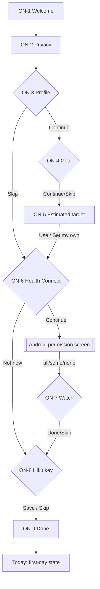
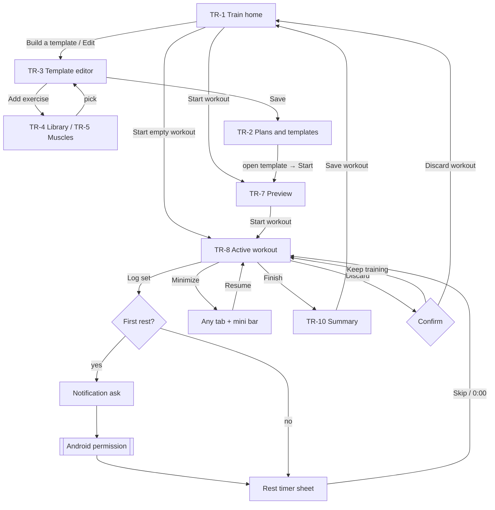
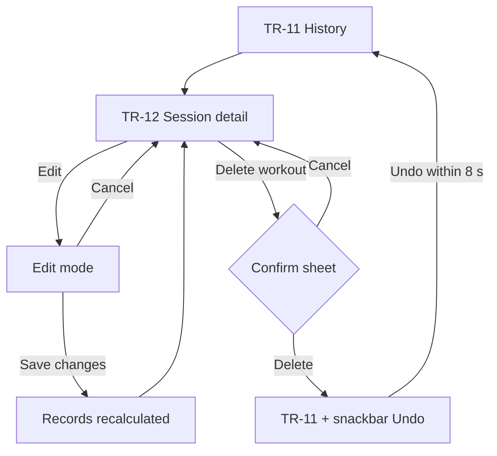

# User Flows

**Milestone 1A** covers flows 1, 6 (setup part) and 7. **Milestone 1B** adds flow 2 and the workout part of flow 10. Flows 3–5, 8, 9 and the rest of 10 are added in 1C–1D.

| # | Flow | Milestone |
|---|---|---|
| 1 | First launch → onboarding → Today | **1A** |
| 2 | Create workout → start → log sets → finish | **1B** |
| 3 | Add meal manually → edit → save | 1C |
| 4 | Meal photo → Hiku → review → save | 1C |
| 5 | Connect Health Connect → permissions → inspect sources | 1D (entry in 1A, ON-6) |
| 6 | Set up API key → first AI request | **1A** (setup), 1C (request) |
| 7 | Open with no internet → continue offline | **1A** |
| 8 | Investigate missing watch data | 1D |
| 9 | Review progress | 1D |
| 10 | Edit or delete data | **1B** (workouts), 1C (meals), 1D (all data) |

---

## Flow 1: First launch → onboarding → Today

| Step | User action | System feedback | Validation and errors | Cancel / recovery |
|---|---|---|---|---|
| ON-1 | Get started | Next screen | — | Back exits the app (nothing saved yet) |
| ON-2 | I understand | Saves "privacy acknowledged" | — | Back to ON-1 |
| ON-3 | Enters data | Inline unit hints | Range errors under each field; Continue disabled until valid or Skip | Back keeps entered values |
| ON-5 | Accepts or edits target | Target saved locally | Safety-floor warning; < 1,000 kcal blocked | "Set my own numbers" → editor sheet; Cancel returns |
| ON-6 | Opens Android permissions | Summary of granted types on return | HC unavailable → update prompt | "Not now" → Today shows "Connect" later |
| ON-8 | Pastes key | Masked; "Saved" | Malformed-key error; offline save allowed | Skip; set later in Settings |
| ON-9 | Open Today | Lands on Today (first day) | — | — |

**Interrupted onboarding:** reopening the app resumes at the last unfinished step. After the Privacy screen, the user can tap "Finish later": Today opens with the remaining steps listed in Getting started.

---

## Flow 6 (setup): Add an Anthropic key

Entry points: ON-8, the Today Hiku card "Add API key", Settings → Hiku, and the Hiku tab's no-key state (1C).

1. The user pastes a key → format check.
2. Save → secure storage → chip changes to "Key saved".
3. Optional "Test key" (online only), with these results:
   - ✓ "Hiku is ready"
   - **401:** "This key is invalid or revoked." Replace it.
   - **403:** "This key isn't allowed to use this model."
   - **429:** "Anthropic is rate limiting this key. Try again in a minute."
   - **Offline:** "Saved. We'll test it when you're online."
4. Delete key (Settings) → confirmation sheet: "Hiku will stop working until you add a key." → removed from secure storage.

The key never appears again after saving: only "Key saved · ending ••a1b2".

---

## Flow 7: Open with no internet

1. App launches → reads local data immediately (no network wait) → Today renders. **Proven on the S22:** offline cold start, local DB and offline Claude failure all PASS (Phase 0, device test 2).
2. Offline banner appears at the top of Today: "Offline. Logging, workouts and your history work as usual. Hiku needs internet."
3. **Hiku entry points:**
   - The Today Hiku card turns into the offline state, and the Photo button is hidden.
   - The Hiku tab shows an offline state with "Log manually instead" (1C).
4. Health Connect still works offline: it's on-device, so steps and HR update normally.
5. Connectivity returns → the banner disappears within 5 s → Hiku re-enables. **No automatic AI requests are sent on reconnect.**
6. If the user starts a Hiku request just as the connection drops, it fails as "You're offline. Nothing was saved." Their text or photo stays in the composer to retry.

---

## Flow 2: Create a workout → start → log sets → finish (1B)

| Step | User action | System feedback | Validation and errors | Cancel / recovery |
|---|---|---|---|---|
| TR-3 | Name, add exercises, set sets × reps and rest, Save | Saved template appears in TR-2; snackbar "Template saved" | Save is disabled until there's a name and one exercise, with a hint. A duplicate name is allowed but gets " (2)". | Back with changes → "Discard changes?" (Keep editing is the default) |
| TR-4/5 | Search or browse, tap exercise, Add | Returns to the editor with the exercise added at the end | No results → "Create '<query>'" | Back returns without adding |
| TR-7 | Start workout | Opens TR-8 at exercise 1, set 1, prefilled from last time | — | Back returns to TR-1; nothing is created yet |
| TR-8 | Adjust kg/reps, Log set | Row ticks, haptic, next set selected, rest sheet opens | 0 reps can't be logged ("Add reps first"). Weight > 500 kg or reps > 100 asks "Is that right?". | Tap the tick to undo the set; values stay editable |
| Rest | −15 / +15 / Skip, or wait | Countdown in the orb and top bar; notification when the screen is off; vibration at 0:00 | Notification denied → in-app alert only, with a banner | Dismiss the sheet; the timer keeps running |
| Minimize | Chevron or system back | Previous screen + mini bar on every tab | — | Resume from the mini bar or TR-1 hero |
| Finish | Finish → Save workout | Summary, records computed, history updated, Today's Training card shows "Done" | Unlogged sets → "3 sets have no reps. Finish anyway?" | "Back to workout" returns to TR-8 |
| App killed mid-workout | — (system) | Next launch opens TR-1 with the in-progress hero; all logged sets intact | Every set is saved on Log set | Resume or Discard |
| Discard | Discard → Discard workout | Workout and its sets deleted; back to TR-1 | — | Keep training is the default button |

## Flow 10 (workouts): Edit or delete a logged workout (1B)

| Step | User action | System feedback | Validation and errors | Cancel / recovery |
|---|---|---|---|---|
| Edit | Pencil → change kg/reps, remove or add sets → Save changes | "Saved. Records updated." Changed records are listed if any moved | Same limits as logging; an exercise with all sets removed asks "Remove Barbell row from this workout?" | Cancel or back → "Discard changes?" |
| Delete | Delete workout → Delete | The sheet names the records that will revert; history shows the snackbar with Undo | — | Cancel is always available; Undo within 8 s restores the workout and its records exactly |
| After Undo expires | — | Deletion is final (local data, no trash in V1) | — | Export/backup is a future feature (1D) |
